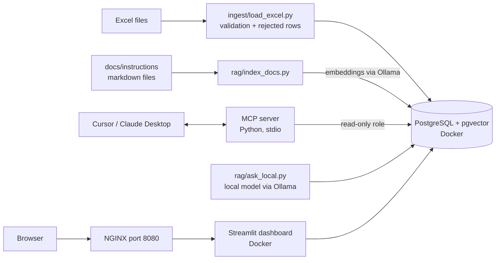

# Factory AI Assistant: home lab project

> Portfolio / home-lab project. **All data is synthetic** (invented). Nothing here comes from a real company.
> Built step by step with AI-assisted development (Cursor).

## Goal

A small internal tool for a PCB manufacturing plant that covers the full cycle of an AI & automation role:
find a manual process → build a working tool in days → connect AI to company data → measure the result.

Users (shift managers, QA engineers, planners) can:

- ask an AI assistant about production orders and defects in plain language (via MCP);
- search work instructions in plain language (RAG), including fully on-premise with a local model;
- see a KPI dashboard.

## Environment

- Windows 10, PowerShell, Docker Desktop, Python 3.10+ in a venv, Git, GitHub.
- Ollama runs natively on Windows (from Step 3).
- All commands in this project are for PowerShell.

## Architecture



| Component | Where it runs | Port |
|---|---|---|
| PostgreSQL 16 + pgvector | Docker (`pgvector/pgvector:pg16`) | 5432 |
| Streamlit dashboard | Docker | 8501 (internal only) |
| NGINX reverse proxy | Docker | 8080 → dashboard |
| MCP server | Windows, Python venv, stdio | none |
| Ollama (embeddings + local chat model) | Windows, native | 11434 |

## Design principles

- **Least privilege:** the MCP server connects with a separate read-only database role.
- **Parameterised SQL only:** never build SQL by string concatenation.
- **No secrets in git:** settings live in `.env` (git-ignored); `.env.example` has placeholders.
- **Data quality first:** every Excel row is validated; rejected rows are reported with a reason.
- **Reproducible:** the whole stack starts with `docker compose up -d`; data is regenerated by a script.
- **Grounded answers:** the assistant answers from the data and documents, and says so when it finds nothing.

## Target repository structure

```
factory-ai-assistant/
├── PROJECT.md
├── README.md
├── docker-compose.yml
├── .env.example              # copy to .env (never commit .env)
├── requirements.txt
├── db/init/01_schema.sql
├── scripts/generate_data.py
├── ingest/load_excel.py
├── mcp_server/server.py
├── rag/index_docs.py
├── rag/ask_local.py
├── dashboard/app.py
├── dashboard/Dockerfile
├── nginx/nginx.conf
├── data/                     # generated Excel files
├── docs/instructions/        # synthetic work instructions for RAG
├── docs/USER_GUIDE.he.md
├── docs/USER_GUIDE.ru.md
├── docs/KPI.md
├── tests/
└── .github/workflows/ci.yml
```

## Rules for the AI assistant (Cursor)

1. Implement ONE step at a time. Do not start the next step until I confirm that the acceptance criteria pass.
2. Before writing code, explain the plan in 3–5 short bullet points in simple language.
3. After the step, list every file you created or changed with one sentence on what it does, and tell me exactly how to check each acceptance criterion.
4. Keep the code simple, readable and commented. No unnecessary frameworks or abstractions.
5. Windows 10 + PowerShell: give commands I can paste as they are.
6. Secrets only in `.env`. Commit `.env.example` with placeholder values.
7. If something fails, explain the cause before changing code.

---

## Step 1: Database and Excel ingestion (Monday)

Build:

- `docker-compose.yml` with one service `db` (image `pgvector/pgvector:pg16`), a named volume, port 5432, a healthcheck, credentials from `.env`.
- `db/init/01_schema.sql`, mounted into `/docker-entrypoint-initdb.d`: enable the `vector` extension and create the tables
  - `orders(order_id PK, customer_sector, product_type, layers, quantity, status, production_line, created_date, due_date)`
  - `defects(defect_id PK, order_id FK → orders, detected_date, station, defect_type, quantity)`
  - `ingest_runs(run_id, file_name, started_at, rows_loaded, rows_rejected)`
- `scripts/generate_data.py`: creates `data/production_orders.xlsx` (~300 orders) and `data/defects.xlsx` (~800 defects) with a fixed random seed. PCB domain values:
  - sectors: Defense, Aerospace, Medical, Industrial
  - product types: Rigid, Rigid-Flex, Flex, HDI (layer counts 2–16)
  - statuses: Planned, In Production, In QA, On Hold, Shipped
  - stations: Imaging, Etching, Lamination, Drilling, Plating, Solder Mask, AOI, Electrical Test, Final QA
  - defect types: Open, Short, Misregistration, Delamination, Plating Void, Solder Mask Defect, Drill Breakout
  - deliberately include ~10 invalid rows: missing order_id, negative quantity, unknown status, due_date before created_date, duplicate order_id, a defect that references a non-existent order.
- `ingest/load_excel.py`: reads both files (pandas + openpyxl), validates every row, loads the valid rows (idempotent: running it again creates no duplicates), writes invalid rows to `data/rejected_rows.csv` with a `reason` column, records the run in `ingest_runs`, prints a summary.
- `tests/test_validation.py`: pytest unit tests for every validation rule (no database needed).
- `requirements.txt`, `.gitignore` (`.venv`, `.env`, `__pycache__`, `data/rejected_rows.csv`), `.env.example`.

Acceptance criteria:

- [ ] `docker compose up -d db` → the container is healthy (`docker compose ps`).
- [ ] `python scripts/generate_data.py` creates both Excel files.
- [ ] `python ingest/load_excel.py` loads the valid rows and reports the rejected count; `data/rejected_rows.csv` lists every planted bad row with a clear reason.
- [ ] Running the loader a second time does not duplicate data.
- [ ] `docker compose exec db psql -U <user> -d <db> -c "SELECT status, COUNT(*) FROM orders GROUP BY status;"` returns counts.
- [ ] `pytest` passes.

## Step 2: MCP server over the database (Tuesday)

Build `mcp_server/server.py` with the official MCP Python SDK (FastMCP), stdio transport.

- Connection settings come from `.env`; connect with a separate **read-only** database role.
- Log to stderr only: stdout is the MCP channel.
- Tools return structured, JSON-serialisable data, never free text:
  - `get_order_status(order_id)` → order details + number of defects; a clear error if the order does not exist.
  - `list_late_orders(as_of_date=None)` → orders past due_date that are not Shipped.
  - `defect_summary(days=30, group_by="station" | "defect_type" | "customer_sector")` → counts and share of total.
- Register the server in Cursor (`.cursor/mcp.json`); optionally also in Claude Desktop.

Acceptance criteria:

- [ ] Cursor's MCP settings show the server as connected, with 3 tools.
- [ ] In chat, "What is the status of order <id>?" calls `get_order_status`, and the answer matches the database.
- [ ] "Which station had the most defects in the last 30 days?" calls `defect_summary`.
- [ ] An unknown order id returns a clean error, not a crash.

## Step 3: RAG over work instructions (Wednesday)

- Install Ollama for Windows; pull `nomic-embed-text` (embeddings, 768 dimensions) and one small chat model (for example `llama3.2:3b`).
- Write 6–8 short synthetic work instructions in `docs/instructions/*.md`: AOI false-call handling, delamination containment, ESD rules, order hold and release, electrical test failure triage, solder mask touch-up limits. Mark each file "Synthetic, for demo only".
- `rag/index_docs.py`: split into chunks (~500 characters, ~50 overlap), get embeddings from Ollama, store them in `doc_chunks(id, source, chunk_index, content, embedding vector(768))`; re-indexing replaces the old chunks.
- Add the MCP tool `search_instructions(query, k=4)` → top-k chunks with the source file and a similarity score (cosine distance, `<=>`).

Acceptance criteria:

- [ ] `python rag/index_docs.py` reports how many chunks were stored.
- [ ] "What should I do if delamination is found?" returns chunks from the delamination instruction first.
- [ ] An unrelated question returns low-similarity results, and the assistant says it found nothing relevant.

## Step 4: Fully on-premise answer with structured output (Wednesday/Thursday)

- `rag/ask_local.py "question"`: retrieves chunks, asks the local Ollama chat model to answer ONLY from those chunks, using Ollama's structured output with the schema `{ "answer": str, "sources": [str], "found": bool }`; validates the result with pydantic; retries once if the JSON is invalid.

Acceptance criteria:

- [ ] The output is always valid JSON that matches the schema.
- [ ] `sources` lists the instruction files actually used.
- [ ] For an off-topic question `found` is false and the answer says so, with no invented content.

## Step 5: KPI dashboard behind NGINX (Thursday)

- `dashboard/app.py` (Streamlit) + `dashboard/Dockerfile`: orders by status, late orders table, defects by station and by type, weekly defect trend, last ingestion runs.
- `nginx/nginx.conf`: reverse proxy from port 8080 to the dashboard container, including the WebSocket upgrade headers that Streamlit needs.
- Add `dashboard` and `nginx` services to `docker-compose.yml`. The dashboard port is not published directly, only through NGINX.

Acceptance criteria:

- [ ] `docker compose up -d` starts db, dashboard and nginx.
- [ ] http://localhost:8080 shows the dashboard with live data.
- [ ] After a new Excel file is loaded, the dashboard shows the change after a refresh.

## Step 6: CI with GitHub Actions (Friday)

- `.github/workflows/ci.yml`: on push and pull request → set up Python → install requirements → lint with ruff → run pytest → build the dashboard Docker image.

Acceptance criteria:

- [ ] Green check on GitHub for the latest commit.
- [ ] Breaking a validation rule on purpose makes the pipeline fail (then revert).

## Step 7: Documentation and training material (Friday)

- `README.md`: what the project is, architecture, how to run it, what each part demonstrates, honest scope (home lab, synthetic data, built with Cursor).
- `docs/USER_GUIDE.he.md` and `docs/USER_GUIDE.ru.md`: one page for a shift manager: what to ask the assistant, examples, what it cannot do, data-safety rules.
- `docs/KPI.md`: how savings would be measured (time of the manual process before vs. with the tool; hours and ₪ per month), with example numbers clearly marked as assumptions.

## Step 8: Optional (Saturday)

- Power Automate Desktop (free on Windows): a desktop flow that takes a new Excel file from an inbox folder, runs the loader, moves the file to `processed/` and shows a summary.
- Cloudflare quick tunnel (`cloudflared`): share the dashboard temporarily through a public URL.
