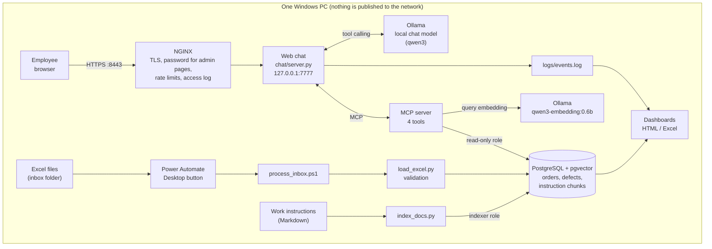
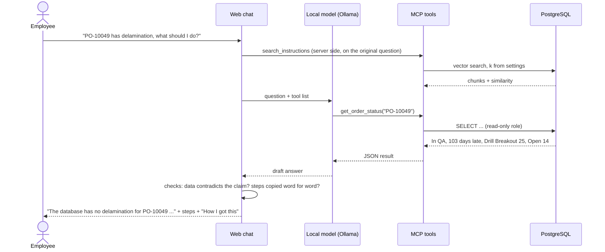
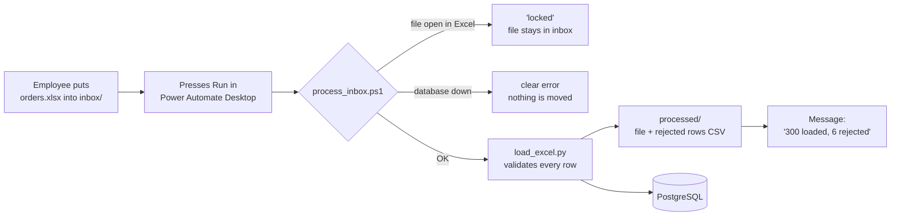

# Factory AI Assistant

A home-lab project: an on-premise AI assistant for a factory.
Shift managers, QA engineers and planners ask questions about production orders,
defects and work instructions in **English, Russian or Hebrew**, and get answers
from the plant's own data. Nothing leaves the computer.

> **Honest scope.** All data and all work instructions are **synthetic** (invented).
> Nothing comes from a real company. It runs on one Windows PC with an
> RTX 5070 (12 GB). It was built in three days with an AI coding agent (Cursor).
> I designed the steps, wrote the requirements and acceptance criteria, tested every
> step, and found and reported the bugs listed below. The agent wrote most of the code.

---

## What it does

| For whom | What they get |
|---|---|
| Shift manager, planner | A web chat: *"What is the status of PO-10049?"*, *"Which orders are late?"*, *"Which station had the most defects in the last 30 days?"* Answers come from the database, never from the model's memory. |
| QA engineer, operator | *"What should I do if delamination is found?"* The steps are shown **word for word** from the work instruction, with the file name, not retold by the model. |
| Any employee | Drop a new Excel file into a folder, press one button (Power Automate Desktop), and get *"300 loaded, 6 rejected"*. |
| Management, admin | Dashboards (production + AI assistant usage), downloadable as HTML or Excel; an event log; an admin panel for all model and search settings, with rollback. |

Every answer has a **"How I got this"** section: which tools were called, with which
arguments, what the database or the search returned, the model, the settings, and the time.

---

## Architecture



| Part | Technology | Why |
|---|---|---|
| Database | PostgreSQL 16 + pgvector in Docker | One place for orders, defects and the instruction search index. |
| Data access for AI | MCP server (Python, official SDK), 4 tools | The model can only call fixed, parameterised queries. It never writes SQL. |
| Instruction search (RAG) | `qwen3-embedding:0.6b`, cosine similarity in pgvector | Multilingual: a Hebrew or Russian question finds an English instruction. |
| Chat model | Ollama, `qwen3:14b` / `qwen3:8b` (switchable in the admin panel) | Fully local. No data goes to a cloud service. |
| Web layer | NGINX in Docker in front of a small Python server | HTTPS, password on admin pages, access log, rate limits. |
| Automation | PowerShell script + Power Automate Desktop flow | A non-programmer loads Excel files with one button. |
| Quality | pytest, ruff, GitHub Actions, PowerShell smoke test | Every push is checked; the running system is checked separately. |

---

## How a question is answered



Rules the chat enforces in code, not only in the prompt:

- Numbers such as *days late* are calculated in SQL, never by the model.
- A procedure is shown word for word from the instruction, grouped by section.
  A Russian or Hebrew user also gets a translation marked *"machine translation, the original above is binding"*.
- If the database contradicts what the user said, the answer says so first.
- If no instruction is found, the answer is a fixed sentence: *contact the shift QA engineer*.
  Answers "from general knowledge" are **off by default** (see issue 8 below).
- One definition of "found" is used by the answer, the log and the dashboards.

---

## Excel to database, by button



- Orders are loaded before defects (a defect must point to an existing order).
- Loading the same file twice creates no duplicates (upsert).
- Every rejected row is written to a CSV with the Excel row number and the reason.
- Exit code: 0 = OK, 1 = some rows rejected, 2 = failed.
- The logic is in the script (tested in CI); Power Automate is only the button and the message.
  With a Power Automate licence, a cloud trigger on a SharePoint/OneDrive folder would replace the button.

---

## Security choices

| Risk | What is done |
|---|---|
| The AI changes or deletes data | The MCP server connects with a **read-only** database role. Re-indexing uses a separate role that can only touch the chunk tables. |
| SQL injection through the model | The model never writes SQL. Tools use fixed, parameterised queries; `group_by` is checked against an allow-list. |
| Services reachable from the network | Every port is bound to `127.0.0.1`. The smoke test fails if anything listens on `0.0.0.0` or `[::]`. |
| Admin pages opened without a password | Password checked by NGINX **and** by the app, so the direct port is not a way around it. |
| Secrets in git or in logs | Secrets only in `.env` (git-ignored). CI fails if `.env`, logs or certificates are tracked. The smoke test fails if any password from `.env` appears in `logs/`. |
| Test traffic counted as real use | Every event has a `source` (user / smoke / test / legacy). Dashboards count only real users by default. |

---

## Measured, not guessed

| What | Result |
|---|---|
| Excel validation | 306 orders and 804 defects generated, with 10 deliberately bad rows. All 10 rejected with a reason; 300 + 800 loaded. |
| Search threshold | Best-chunk similarity, 21 questions in EN/RU/HE: English on-topic 0.63–0.82, Russian 0.49–0.63, Hebrew 0.48–0.63; off-topic up to 0.51. **0.48** gave the fewest mistakes across the three languages. |
| How many chunks to retrieve (k) | k=4 missed required steps in some questions; **k=6** found the right file 12/12 and the required text 10/10 in every language; k=8 added nothing. |
| Embedding model | `qwen3-embedding:0.6b` chosen over `bge-m3` and `nomic-embed-text` (English-only) on this project's EN/RU/HE questions. |
| Chat model speed (RTX 5070, 12 GB) | English order questions: 6–10 s with `qwen3:14b` once the model is loaded (about 30 s on a cold start). Russian/Hebrew procedure questions: 40 s to over 4 minutes (see open issues). `qwen3:8b` without thinking: about 2× faster, but less safe (issue 12). |
| Automated checks | 160+ unit tests (pytest), ruff, Docker Compose validation and a tracked-secrets check on every push (GitHub Actions); a 30+ check smoke test against the running system. |

---

## Issues found by testing

I tested the system the way a QA engineer would: three languages, follow-up questions,
false premises, off-topic questions, the logs and the CI output.

| # | What I found | Why it mattered | Status |
|---|---|---|---|
| 1 | After changing the embedding model, the chunk with the first actions dropped out of the top 4. | The answer missed the most important steps. | Fixed: k=6, chosen by measurement. |
| 2 | Chunking split a numbered list; step 5 disappeared. | Incomplete procedure. | Fixed: chunks follow Markdown structure, lists stay whole. |
| 3 | The admin panel could be opened on the direct port without a password. | Security bypass. | Fixed: password checked in NGINX and in the app. |
| 4 | The database listened on all network interfaces with the default password. | Anyone on the home Wi-Fi could connect. | Fixed: bound to 127.0.0.1, password replaced, smoke test checks it. |
| 5 | Test traffic was counted in the assistant dashboard. | Usage numbers were not real. | Fixed: events tagged by source. |
| 6 | "Which orders are late?" — the model invented the date (2023). "16 days late" for an order 103 days late. | Wrong numbers that look right. | Fixed: dates and day counts come from SQL. |
| 7 | A Hebrew question was rewritten by the model with Cyrillic letters inside a word before searching. | Search received a broken query. | Fixed: search uses the user's original question. |
| 8 | A Russian delamination question skipped the search, and a "general knowledge" mode advised repairing with epoxy. | Contradicted the plant instruction ("do not rework"). | Fixed: instruction search runs on the server for every non-data question; general knowledge is off by default. |
| 9 | Answers retold procedures and dropped steps (e.g. "hold the whole press load", "do not bake"). | Unsafe omissions. | Fixed: steps are shown word for word. |
| 10 | "PO-10049 has delamination" was accepted, although the database shows other defects. | The assistant confirmed a false claim. | Fixed: a contradiction with the data is stated first. |
| 11 | The admin panel said k=6, but the code used a hard-coded k=10. | Settings on screen did not match behaviour. | Fixed: the panel is the only source of settings; a test checks it. |
| 12 | `qwen3:8b` with thinking off advised "fix the defects and prepare the order for shipping" for a Medical order. | Repair is forbidden for Medical boards. | Open: use `qwen3:14b` with thinking; guardrail planned. |
| 13 | A follow-up ("what type are **its** defects?") was answered with the previous answer or not at all. | Broken conversation. | Fixed: the order is taken from the earlier turn; tests for EN, RU and HE. |
| 14 | Unit tests passed on Windows but failed in CI: `powershell` does not exist on Linux. | "Works on my machine". | Fixed: tests use `pwsh` (PowerShell 7). |

---

## Known limits

- **Speed.** Non-English procedure answers can take minutes. Likely cause: the 14B model and the embedding model together do not fit in 12 GB, so part runs on the CPU. Next step: compare `qwen3.5:9b` and `gemma4:12b` (smaller, newer) on the same questions.
- **Intent detection is rule-based.** Deciding "data question / procedure / small talk" uses keyword patterns in three languages. It works for the tested phrasings and will miss others. A labelled question set (next step) would show how often.
- **One similarity threshold for three languages.** Russian and Hebrew questions score lower than English ones. Searching with an English translation as well is a possible fix.
- **Basic auth.** No logout and no session expiry. In a company this would be single sign-on (Microsoft Entra ID / Google).
- **Self-signed certificate.** The browser warns. In a company the certificate would come from the internal CA.
- **No real MES/ERP.** Data comes from Excel exports. A real deployment would read the MES/ERP database or API with the same read-only approach.
- **Not yet built:** an automatic regression set of ~30 questions with expected answers, and auto-calibration of the settings against it.

---

## Run it (Windows 10/11)

Requirements: Docker Desktop, Python 3.11, Ollama, Git, PowerShell.

```powershell
git clone https://github.com/AlenK77777/factory-ai-assistant.git
cd factory-ai-assistant
python -m venv .venv
.\.venv\Scripts\Activate.ps1
pip install -r requirements.txt

Copy-Item .env.example .env          # then set your own passwords in .env
ollama pull qwen3-embedding:0.6b
ollama pull qwen3:8b                 # default chat model; qwen3:14b is better, if it fits

docker compose up -d db
python scripts/generate_data.py      # synthetic Excel files
python ingest/load_excel.py          # validate and load
python rag/index_docs.py             # index the work instructions
```

Then double-click **`start-chat.bat`**. It checks Docker, the database and Ollama,
starts the chat and NGINX, and opens https://localhost:8443.
Admin, Dashboards and Logs ask for the user `admin` and `ADMIN_PASSWORD` from `.env`.
`stop-chat.bat` stops everything (`stop-chat.bat all` also stops the database).

Checks:

```powershell
ruff check .
pytest -m "not integration"                                        # same as CI
powershell -ExecutionPolicy Bypass -File scripts\smoke_proxy.ps1  # running system
```

---

## Repository map

```
chat/            web chat, chat loop (rules above), admin settings, event log, admin auth
mcp_server/      MCP server: get_order_status, list_late_orders, defect_summary, search_instructions
rag/             embeddings, structure-aware chunking and indexing, retrieval, language checks
ingest/          Excel validation and loading
dashboard/       production and assistant numbers; HTML (inline SVG) and Excel exports
db/init/         schema, read-only role, chunk table, indexer role
nginx/           reverse proxy config
scripts/         data generator, certificates, smoke test, inbox loader for Power Automate
docs/instructions/  7 synthetic work instructions (delamination, ESD, AOI, hold/release, ...)
tests/           pytest unit tests (database and Ollama are mocked in CI)
PROJECT.md       the step-by-step plan and acceptance criteria the agent worked from
```

---

## How this was built

1. I wrote the plan in `PROJECT.md`: one step at a time, each with acceptance criteria.
2. The agent proposed a short plan for each step; I approved or corrected it before any code was written.
3. After each step I ran the checks myself (database queries, the chat in three languages, the logs, the smoke test, CI) and committed only when they passed.
4. Every bug in the table above was found by testing and turned into a fix **and** a test, so it cannot quietly come back.

---

## In my words: what was hardest

**Three languages, one threshold.** The instructions are in English, but people ask in
English, Russian and Hebrew. The same question scores 0.63–0.82 in English and only
0.48–0.63 in Russian or Hebrew, while off-topic questions reach 0.51. I measured 21
questions in all three languages and chose 0.48 as the value with the fewest mistakes.
Then I made the system safe around that border: a Russian or Hebrew question that finds
nothing is searched again in English, and the procedure is shown word for word with a
marked translation, so the original text is always there.

**Keeping the model on the facts.** A language model always wants to answer. It invented
a date, counted days late on its own and agreed with a defect the order never had. I moved
every fact out of the model's hands: numbers come from SQL, steps come from the instruction
text, and a contradiction with the database is stated first.

**Testing every change in all three languages.** A fix that worked in English could
change the behaviour in Hebrew. After every change I ran the same set of questions in
English, Russian and Hebrew, including follow-ups, false premises and off-topic questions,
and each problem I found became an automated test.

**Speed against safety.** A smaller model answered twice as fast, but on a Russian question
it gave advice that broke the plant's repair rules. I measured both and chose by the quality
of the answer, not only by speed.
