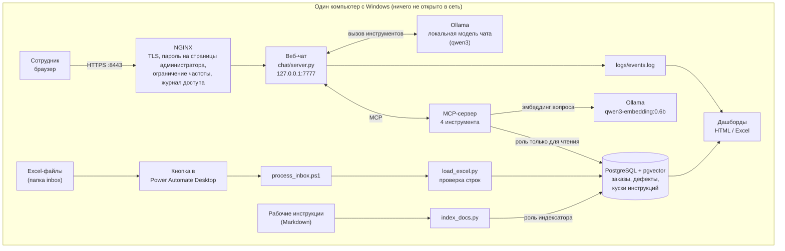
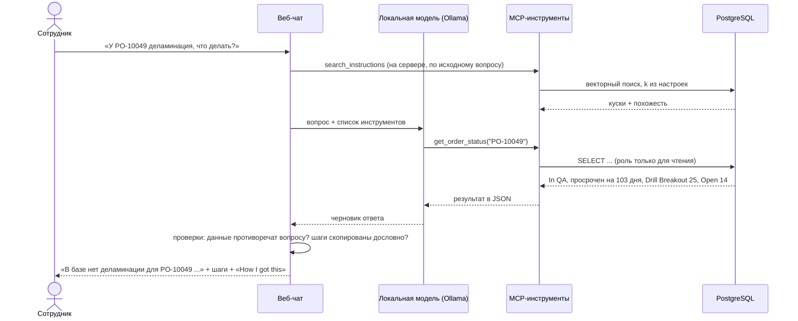
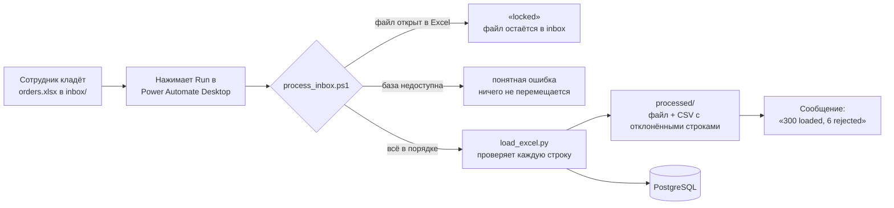

# Factory AI Assistant — ИИ-ассистент для завода печатных плат

Домашний проект: ИИ-ассистент для завода печатных плат, который работает целиком
на месте, без облака. Начальники смен, QA-инженеры и планировщики задают вопросы
о производственных заказах, дефектах и рабочих инструкциях на **английском, русском
или иврите** и получают ответы из данных самого завода. Ничего не уходит за пределы компьютера.

> **Честные рамки.** Все данные и все рабочие инструкции **синтетические** (выдуманные).
> Ничего не взято из реальной компании. Система работает на одном компьютере с Windows
> и видеокартой RTX 5070 (12 ГБ). Сделана за три дня с помощью ИИ-агента для разработки (Cursor).
> Я спланировал этапы, написал требования и критерии приёмки, проверял каждый этап,
> нашёл и описал ошибки, перечисленные ниже. Большую часть кода написал агент.

---

## Что умеет система

| Для кого | Что получает |
|---|---|
| Начальник смены, планировщик | Веб-чат: *«Какой статус у заказа PO-10049?»*, *«Какие заказы просрочены?»*, *«На какой станции больше всего дефектов за 30 дней?»* Ответы берутся из базы данных, а не из памяти модели. |
| QA-инженер, оператор | *«Что делать, если обнаружена деламинация?»* Шаги показываются **дословно** из рабочей инструкции, с названием файла, а не пересказываются моделью. |
| Любой сотрудник | Кладёт новый Excel-файл в папку, нажимает одну кнопку (Power Automate Desktop) и получает *«300 loaded, 6 rejected»*. |
| Руководство, администратор | Дашборды (производство + использование ассистента) с выгрузкой в HTML и Excel; журнал событий; панель администратора со всеми настройками модели и поиска и откатом изменений. |

У каждого ответа есть раздел **«How I got this»** («Как я это получил»): какие инструменты
вызывались и с какими аргументами, что вернули база или поиск, какая модель и настройки
использовались, сколько заняло время.

---

## Архитектура



| Часть | Технология | Зачем |
|---|---|---|
| База данных | PostgreSQL 16 + pgvector в Docker | Одно место для заказов, дефектов и поискового индекса инструкций. |
| Доступ ИИ к данным | MCP-сервер (Python, официальный SDK), 4 инструмента | Модель может вызывать только заранее заданные параметризованные запросы. SQL она не пишет никогда. |
| Поиск по инструкциям (RAG) | `qwen3-embedding:0.6b`, косинусная похожесть в pgvector | Многоязычный: вопрос на иврите или по-русски находит английскую инструкцию. |
| Модель чата | Ollama, `qwen3:14b` / `qwen3:8b` (переключается в панели администратора) | Полностью локально. Никакие данные не уходят в облако. |
| Веб-слой | NGINX в Docker перед небольшим Python-сервером | HTTPS, пароль на страницах администратора, журнал доступа, ограничение частоты запросов. |
| Автоматизация | PowerShell-скрипт + поток Power Automate Desktop | Сотрудник без навыков программирования загружает Excel одной кнопкой. |
| Качество | pytest, ruff, GitHub Actions, smoke-тест на PowerShell | Каждый push проверяется автоматически; работающая система проверяется отдельно. |

---

## Как отвечает ассистент



Правила, которые чат соблюдает в коде, а не только в инструкции для модели:

- Числа вроде *дней просрочки* считает SQL, а не модель.
- Процедура показывается дословно из инструкции, по разделам.
  Пользователь на русском или иврите получает ещё и перевод с пометкой
  *«машинный перевод, обязателен оригинал выше»*.
- Если база противоречит словам пользователя, ответ говорит об этом первым.
- Если инструкция не найдена, ответ — фиксированная фраза: *обратитесь к QA-инженеру смены*.
  Ответы «из общих знаний» **выключены по умолчанию** (см. ошибку 8 ниже).
- «Найдено» определяется одинаково для ответа, журнала и дашбордов.

---

## Excel в базу одной кнопкой



- Заказы загружаются раньше дефектов (дефект должен ссылаться на существующий заказ).
- Повторная загрузка того же файла не создаёт дублей (upsert).
- Каждая отклонённая строка записывается в CSV с номером строки Excel и причиной.
- Код выхода: 0 — всё в порядке, 1 — часть строк отклонена, 2 — ошибка.
- Вся логика в скрипте (он проверяется в CI); Power Automate — только кнопка и сообщение.
  С лицензией Power Automate кнопку заменил бы облачный триггер на папку в SharePoint или OneDrive.

---

## Решения по безопасности

| Риск | Что сделано |
|---|---|
| ИИ изменит или удалит данные | MCP-сервер подключается к базе ролью **только для чтения**. Переиндексация идёт под отдельной ролью, которой доступны только таблицы с кусками инструкций. |
| SQL-инъекция через модель | Модель не пишет SQL. Инструменты используют фиксированные параметризованные запросы; `group_by` сверяется со списком разрешённых значений. |
| Сервисы доступны из сети | Все порты привязаны к `127.0.0.1`. Smoke-тест падает, если что-то слушает `0.0.0.0` или `[::]`. |
| Страницы администратора без пароля | Пароль проверяют и NGINX, **и** само приложение, поэтому прямой порт не позволяет обойти защиту. |
| Секреты в git или в журналах | Секреты только в `.env` (исключён из git). CI падает, если в репозиторий попали `.env`, журналы или сертификаты. Smoke-тест падает, если любой пароль из `.env` встречается в `logs/`. |
| Тестовый трафик считается как реальный | У каждого события есть `source` (user / smoke / test / legacy). Дашборды по умолчанию считают только реальных пользователей. |

---

## Измерено, а не угадано

| Что | Результат |
|---|---|
| Проверка Excel | Сгенерировано 306 заказов и 804 дефекта, среди них 10 специально испорченных строк. Все 10 отклонены с указанием причины; загружено 300 + 800. |
| Порог поиска | Похожесть лучшего куска, 21 вопрос на EN/RU/HE: английские вопросы по теме 0,63–0,82, русские 0,49–0,63, на иврите 0,48–0,63; вопросы не по теме — до 0,51. Порог **0,48** дал меньше всего ошибок на трёх языках. |
| Сколько кусков доставать (k) | При k=4 в части вопросов терялись обязательные шаги; при **k=6** нужный файл найден в 12 из 12 случаев, а обязательный текст — в 10 из 10 на каждом языке; k=8 ничего не добавил. |
| Модель эмбеддингов | `qwen3-embedding:0.6b` выбрана вместо `bge-m3` и `nomic-embed-text` (только английский) по замерам на вопросах проекта на трёх языках. |
| Скорость модели чата (RTX 5070, 12 ГБ) | Вопросы о заказах на английском: 6–10 с на `qwen3:14b` после загрузки модели (около 30 с при холодном старте). Вопросы о процедурах на русском и иврите: от 40 с до 4 минут и больше (см. ограничения). `qwen3:8b` без рассуждения: примерно вдвое быстрее, но менее безопасна (ошибка 12). |
| Автоматические проверки | 160+ модульных тестов (pytest), ruff, проверка Docker Compose и проверка на секреты в репозитории при каждом push (GitHub Actions); smoke-тест на работающей системе — 30+ проверок. |

---

## Ошибки, найденные тестированием

Я проверял систему так, как это делает QA-инженер: три языка, уточняющие вопросы,
ложные предпосылки, вопросы не по теме, журналы и вывод CI.

| № | Что найдено | Чем это опасно | Статус |
|---|---|---|---|
| 1 | После смены модели эмбеддингов кусок с первыми действиями выпал из первой четвёрки. | Ответ терял самые важные шаги. | Исправлено: k=6, выбрано замером. |
| 2 | Нарезка разрезала нумерованный список; пропал шаг 5. | Неполная процедура. | Исправлено: куски следуют структуре Markdown, списки не режутся. |
| 3 | Панель администратора открывалась без пароля через прямой порт. | Обход защиты. | Исправлено: пароль проверяют и NGINX, и приложение. |
| 4 | База слушала все сетевые интерфейсы с паролем по умолчанию. | К ней мог подключиться любой в домашней сети Wi-Fi. | Исправлено: привязка к 127.0.0.1, пароль заменён, smoke-тест это проверяет. |
| 5 | Тестовый трафик учитывался в дашборде ассистента. | Цифры использования были ненастоящими. | Исправлено: события помечаются по источнику. |
| 6 | «Какие заказы просрочены?» — модель выдумала дату (2023 год). «Просрочен на 16 дней» для заказа, просроченного на 103 дня. | Неверные цифры, которые выглядят правдоподобно. | Исправлено: даты и число дней считает SQL. |
| 7 | Модель переписала вопрос на иврите перед поиском и вставила кириллицу внутрь слова. | Поиск получал испорченный запрос. | Исправлено: поиск идёт по исходному вопросу пользователя. |
| 8 | Русский вопрос про деламинацию обошёл поиск, а режим «общих знаний» посоветовал ремонт эпоксидной смолой. | Противоречит инструкции завода («не перерабатывать»). | Исправлено: поиск по инструкциям запускается на сервере для каждого вопроса, не связанного с данными; общие знания по умолчанию выключены. |
| 9 | Ответы пересказывали процедуры и теряли шаги (например, «удержать всю загрузку пресса», «не запекать»). | Опасные пропуски. | Исправлено: шаги показываются дословно. |
| 10 | Утверждение «У PO-10049 деламинация» было принято, хотя в базе у заказа другие дефекты. | Ассистент подтвердил ложное утверждение. | Исправлено: противоречие с данными называется первым. |
| 11 | Панель администратора показывала k=6, а код использовал жёстко заданное k=10. | Настройки на экране не совпадали с поведением. | Исправлено: панель — единственный источник настроек; это проверяет тест. |
| 12 | `qwen3:8b` без рассуждения посоветовала «устранить дефекты и подготовить заказ к отгрузке» для заказа Medical. | Ремонт плат Medical запрещён. | Открыто: использовать `qwen3:14b` с рассуждением; запланирована дополнительная защита. |
| 13 | Уточняющий вопрос («какого типа **у него** дефекты?») получал прошлый ответ или не получал ответа. | Разговор ломался. | Исправлено: заказ берётся из предыдущего вопроса; тесты на EN, RU и HE. |
| 14 | Модульные тесты проходили на Windows, но падали в CI: на Linux нет `powershell`. | «У меня работает». | Исправлено: тесты используют `pwsh` (PowerShell 7). |

---

## Известные ограничения

- **Скорость.** Ответы на процедурные вопросы не на английском могут занимать минуты. Вероятная причина: модель 14B вместе с моделью эмбеддингов не помещается в 12 ГБ, и часть работы уходит на процессор. Следующий шаг: сравнить на тех же вопросах `qwen3.5:9b` и `gemma4:12b` (меньше и новее).
- **Тип вопроса определяется правилами.** Решение «вопрос о данных / процедура / разговор» принимается по ключевым словам на трёх языках. Для проверенных формулировок это работает, другие формулировки могут быть пропущены. Размеченный набор вопросов (следующий шаг) покажет, как часто.
- **Один порог похожести на три языка.** Русские вопросы и вопросы на иврите получают меньшую похожесть, чем английские. Частично это компенсирует повторный поиск на английском.
- **Basic auth.** Нет кнопки «выйти» и срока действия входа. В компании здесь был бы единый вход (Microsoft Entra ID / Google).
- **Самоподписанный сертификат.** Браузер предупреждает. В компании сертификат выдавал бы внутренний центр сертификации.
- **Нет настоящей MES/ERP.** Данные приходят из выгрузок Excel. В реальном внедрении система читала бы базу или API MES/ERP с тем же подходом «только чтение».
- **Ещё не сделано:** автоматический набор из ~30 контрольных вопросов с ожидаемыми ответами и автокалибровка настроек по нему.

---

## Как запустить (Windows 10/11)

Нужно: Docker Desktop, Python 3.11, Ollama, Git, PowerShell.

```powershell
git clone https://github.com/AlenK77777/factory-ai-assistant.git
cd factory-ai-assistant
python -m venv .venv
.\.venv\Scripts\Activate.ps1
pip install -r requirements.txt

Copy-Item .env.example .env          # затем задайте свои пароли в .env
ollama pull qwen3-embedding:0.6b
ollama pull qwen3:8b                 # модель по умолчанию; qwen3:14b лучше, если помещается

docker compose up -d db
python scripts/generate_data.py      # синтетические Excel-файлы
python ingest/load_excel.py          # проверка и загрузка
python rag/index_docs.py             # индексация рабочих инструкций
```

Затем дважды щёлкните **`start-chat.bat`**. Он проверяет Docker, базу и Ollama,
запускает чат и NGINX и открывает https://localhost:8443.
Страницы Admin, Dashboards и Logs спрашивают пользователя `admin` и `ADMIN_PASSWORD` из `.env`.
`stop-chat.bat` всё останавливает (`stop-chat.bat all` останавливает и базу).

Проверки:

```powershell
ruff check .
pytest -m "not integration"                                        # то же, что в CI
powershell -ExecutionPolicy Bypass -File scripts\smoke_proxy.ps1  # работающая система
```

---

## Карта репозитория

```
chat/            веб-чат, логика ответа (правила выше), настройки администратора, журнал событий, авторизация
mcp_server/      MCP-сервер: get_order_status, list_late_orders, defect_summary, search_instructions
rag/             эмбеддинги, нарезка по структуре и индексация, поиск, проверка языка
ingest/          проверка и загрузка Excel
dashboard/       цифры производства и ассистента; выгрузка в HTML (встроенный SVG) и Excel
db/init/         схема, роль только для чтения, таблица кусков, роль индексатора
nginx/           настройки обратного прокси
scripts/         генератор данных, сертификаты, smoke-тест, загрузчик inbox для Power Automate
docs/instructions/  7 синтетических рабочих инструкций (деламинация, ESD, AOI, удержание заказа, ...)
tests/           модульные тесты pytest (база и Ollama в CI подменяются заглушками)
PROJECT.md       пошаговый план и критерии приёмки, по которым работал агент
```

---

## Как это делалось

1. Я написал план в `PROJECT.md`: по одному этапу за раз, у каждого — критерии приёмки.
2. Перед каждым этапом агент предлагал короткий план; я утверждал или исправлял его до того, как появлялся код.
3. После каждого этапа я сам запускал проверки (запросы к базе, чат на трёх языках, журналы, smoke-тест, CI) и делал коммит только когда всё проходило.
4. Каждая ошибка из таблицы выше найдена тестированием и превращена в исправление **и** тест, чтобы она не вернулась незаметно.

---

## Своими словами: что было труднее всего

**Три языка, один порог.** Инструкции написаны на английском, а спрашивают на английском,
русском и иврите. Один и тот же вопрос на английском даёт похожесть 0,63–0,82, а на русском
или иврите — только 0,48–0,63, при этом вопросы не по теме доходят до 0,51. Я замерил
21 вопрос на трёх языках и выбрал 0,48 как значение с наименьшим числом ошибок. Затем сделал
систему надёжной вокруг этой границы: если вопрос на русском или иврите ничего не нашёл,
поиск повторяется на английском, а процедура показывается дословно вместе с помеченным
переводом, так что исходный текст всегда перед глазами.

**Удержать модель на фактах.** Языковая модель всегда стремится ответить. Она выдумала дату,
сама считала дни просрочки и согласилась с дефектом, которого у заказа никогда не было.
Я вывел все факты из-под контроля модели: числа считает SQL, шаги берутся из текста
инструкции, а противоречие с базой называется первым.

**Проверять каждое изменение на трёх языках.** Исправление, работающее на английском, могло
изменить поведение на иврите. После каждого изменения я прогонял один и тот же набор вопросов
на английском, русском и иврите, включая уточняющие вопросы, ложные предпосылки и вопросы
не по теме, и каждая найденная проблема становилась автоматическим тестом.

**Скорость против безопасности.** Модель поменьше отвечала вдвое быстрее, но на русском
вопросе дала совет, нарушающий правила ремонта на заводе. Я замерил обе и выбирал по качеству
ответа, а не только по скорости.
